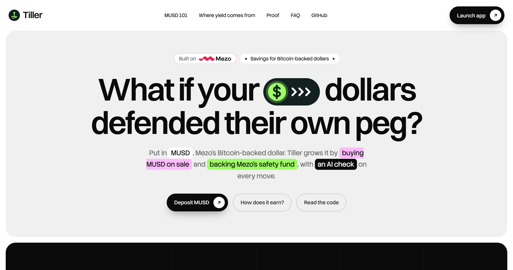
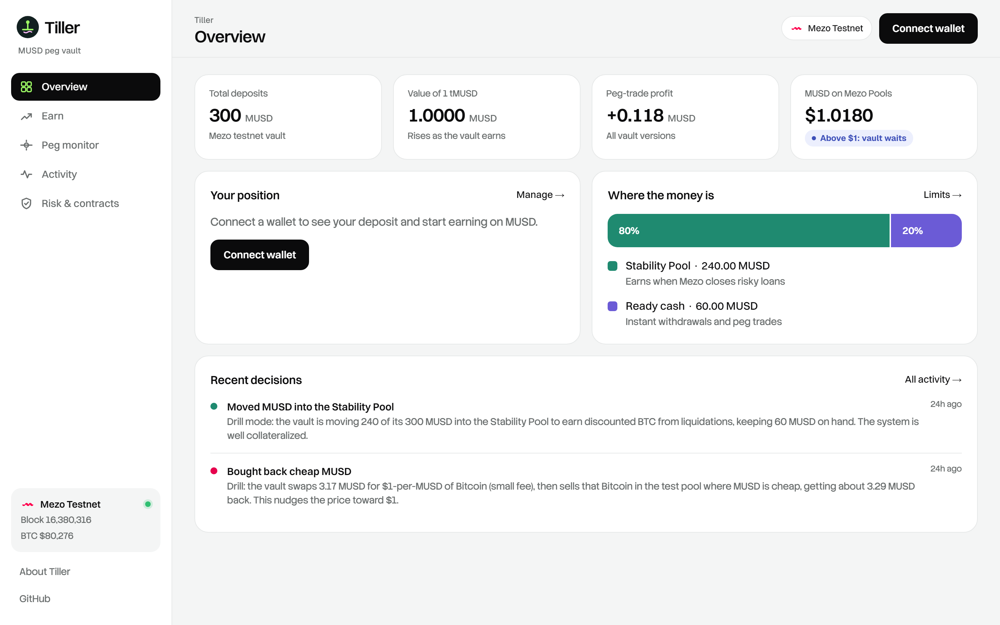
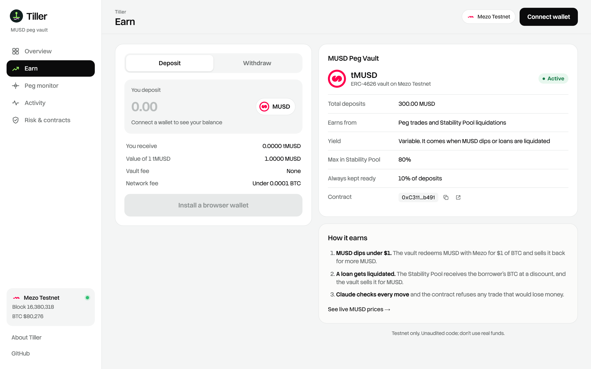
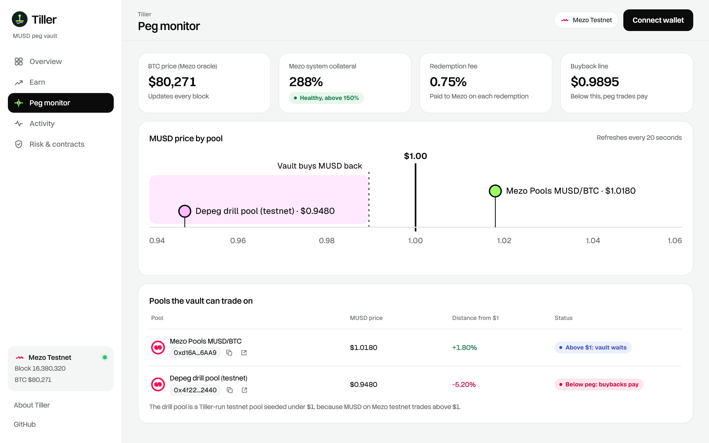
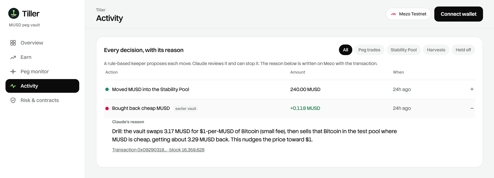

# Tiller Finance

**MUSD savings that make MUSD stronger.**

Tiller is a vault for MUSD, Mezo's Bitcoin-backed dollar. It earns by doing the job that keeps a stablecoin at $1, in both directions. When MUSD trades cheap, the vault buys it back through Mezo's redemption mechanism, or with mUSDC it holds, and keeps the difference. When MUSD trades above $1, it sells MUSD for mUSDC. Between depegs, it backs Mezo's Stability Pool. A rule-based keeper proposes every move, Claude reviews it and can stop it, and every reason is written on-chain.

**Live:** [tillerfinance.xyz](https://tillerfinance.xyz) · **Vault app:** [tillerfinance.xyz/app](https://tillerfinance.xyz/app) · **Code:** [github.com/fahmmin/tiller-finance](https://github.com/fahmmin/tiller-finance) · **Telegram:** [@tillerfinancebot](https://t.me/tillerfinancebot) · **Network:** Mezo testnet (chain 31611) · **Track:** Track 1, DeFi



| Overview | Earn |
|---|---|
|  |  |
| **Peg monitor** | **Activity** |
|  |  |

---

## Wave 2: what's new

| | Wave 1 | Wave 2 |
|---|---|---|
| **Peg defence** | Below $1 only, by redemption | **Both directions.** Below $1 by redemption, or by buying MUSD back with mUSDC. Above $1.005, by selling MUSD for mUSDC through Mezo's MUSD/mUSDC pool |
| **Redemption size** | First trove only, sized by hand | **Across up to 50 troves.** The vault redeems exactly what Mezo's HintHelpers says it can, and the keeper sizes every trade by simulating the vault call against Mezo's real contracts |
| **Where trades happen** | A labelled drill pool | **Mezo's own pools only.** The drill pool isn't whitelisted on v4 |
| **Limits** | SP cap, cash floor, slippage | Plus a **30% mUSDC cap**, a **$1.005 sell floor**, a **$1.00 buy ceiling**, and a **deposit cap** (100,000 MUSD on testnet, 5,000 planned for mainnet) |
| **Admin** | Deployer wallet | **Timelock.** Every limit, pool or cap change waits in public first (1 hour on testnet, 48 hours on mainnet). The guardian can still pause at once, and pausing never blocks withdrawals |
| **Tests** | 15 | **23 unit tests plus a randomised invariant test**, run at 200 seeds × 60 steps. It found a real bug: `maxRedeem` rounded 1 wei short, so the last depositor couldn't redeem every share. Fixed |
| **Depositor updates** | Website only | **Telegram bot, [@tillerfinancebot](https://t.me/tillerfinancebot).** `/status`, `/why`, `/peg`, `/alerts`, and plain-English questions answered by Claude from the on-chain decision log |
| **Onboarding** | Borrow 1,800 MUSD on Mezo first | **One-click faucet**: 100 test MUSD plus BTC for gas, one claim per wallet, sent by the site so a wallet with no BTC can start ([`TillerFaucet`](contracts/contracts/TillerFaucet.sol)) |
| **Traction, in public** | None | **[tillerfinance.xyz/stats](https://tillerfinance.xyz/stats)**: depositors, deposits, value locked over time, peg trades, faucet claims and bot users, all read from Mezo testnet. **[Peg Defenders](https://tillerfinance.xyz/app/leaderboard)**: a leaderboard with a shareable defender card |
| **Always on** | Keeper ran on a laptop | **Cloudflare Worker**: the keeper runs every 10 minutes on a cron, and the Telegram bot answers through a webhook, so nothing depends on one machine ([`app/worker`](app/worker/index.ts)) |
| **Mainnet** | Not ready | Deploy script and config ready (`--network mezomainnet`, mainnet addresses filled in). Not deployed: the code isn't audited yet |

**A real depeg on Mezo testnet (Nov 11, 2026).** Mezo's own MUSD/BTC pool priced MUSD at **$0.94**, and the MUSD/mUSDC pool at **$0.81**. The keeper simulated the vault's `pegArb` on v4 against Mezo's live contracts: redeeming all **299 MUSD** returns **+15.67 MUSD (5.2%)**, with no drill pool involved. The trade wasn't sent. The keeper's Claude API key had no credits, so the review failed closed and vetoed it, which is the behaviour we want.

---

## Results: tested on chain, not on slides

Wave 1, run on Mezo testnet on **Oct 25, 2026** against vault v2/v3. Every row is a transaction anyone can open.

| What happened | Result | Proof |
|---|---|---|
| **Peg trade:** the vault redeemed 3.167 MUSD for $1 of BTC each through Mezo, then sold the BTC back in a pool pricing MUSD at $0.95 | **+0.118 MUSD profit, 3.7% on the trade**, in one transaction, approved by Claude | [`0x0929…a450`](https://explorer.test.mezo.org/tx/0x092903187a0c792c4fe03a46482867826468a33321f5a1f82d13239274ea4450) |
| **Peg pressure:** that single buyback moved the pool's MUSD price | **$0.9505 → $0.9572** (+0.7%) | same tx |
| **Stability Pool:** the vault moved its spare MUSD into Mezo's Stability Pool | **240 MUSD deployed**, exactly the 80% cap, 60 MUSD kept liquid | [`0xfd1d…2ca6`](https://explorer.test.mezo.org/tx/0xfd1d2fe94343dc0b6ffccc17db0c7b2682b6ce3e188b8663e36e071c9d192ca6) |
| **AI veto:** Claude was given a plan whose expected profit was wrong | **Vetoed.** "Redeeming 500 MUSD after the 0.75% fee gives about $496.25 of BTC… returns only about 506.4 MUSD, not the proposed 508.40." | keeper smoke test |
| **Guardrail:** keeper simulated a peg trade when Mezo would cancel the redemption | **Nothing sent**: the trade reverted in simulation, and the vault stayed whole | keeper log |
| **Automated tests** | **15 passing** in Wave 1 (10 contract, 5 keeper); 23 unit tests plus the invariant test in Wave 2 | `npx hardhat test`, `npm test` |

The vault's share price went up by exactly the trade profit: **300.000 → 300.118 MUSD** of assets for 300 shares.

**About the 5% drill.** Testnet MUSD trades *above* $1 (about $1.02), so there's no below-peg trade to make on Mezo's testnet pool. To show the full loop, we seeded a small, clearly labelled "depeg drill" pool at $0.95 and whitelisted it. The redemption itself is real: it ran against Mezo's TroveManager and burned real testnet MUSD. On mainnet the vault would only whitelist Mezo's own pools. Profit scales with pool depth and the size of the depeg; on Oct 25, mainnet MUSD sat at **$0.9926**, right at the redemption floor.

---

## Why this matters

A stablecoin's floor is only as strong as the people willing to buy it back. MUSD can always be redeemed for $1 of BTC minus a 0.75% fee, and that is what holds the floor, but only if someone runs the trade. Running it means redemption hints that go stale every block, knowing the trove queue, and a route to sell the BTC. Today that's people with their own bots.

Tiller packages that trade into a deposit. Every MUSD in Tiller is MUSD standing ready to defend the peg. Of the 44 Wave 1 Buildathon entries, **none other defends the peg**.

---

## How it works

```
 depositors ──MUSD──▶ TillerVault  (ERC-4626, tMUSD shares)
                         │
        ┌────────────────┼──────────────────────────────────┐
        ▼                ▼                                  ▼
   idle buffer     Mezo Stability Pool                 peg trade
   (≥10%, for      provideToSP / withdrawFromSP         HintHelpers + SortedTroves  (same tx)
   withdrawals)    BTC from liquidations                TroveManager.redeemCollateral
                     └─ harvest ─▶ Mezo pool ─▶ MUSD    BTC ─▶ Mezo pool ─▶ more MUSD
                                                        reverts unless MUSD ends higher

 keeper: read Mezo ─▶ plan with fixed rules ─▶ Claude review (approve / veto)
                    ─▶ simulate ─▶ send ─▶ check receipt ─▶ Decision event with the reason
```

### Hard limits enforced by the contract

Neither the keeper nor the AI can get around these.

| Guardrail | How |
|---|---|
| Only the keeper can move funds; a guardian can pause | `KEEPER_ROLE`, `GUARDIAN_ROLE` |
| At most 80% in the Stability Pool, at least 10% ready for withdrawals | `spCapBps`, `minIdleBps`, checked after every deposit |
| Swaps only through whitelisted MUSD/BTC and MUSD/mUSDC pools | `setPool` / `setStablePool` check the pair |
| MUSD sold only at $1.005 or more, bought back only at $1.00 or less | `pegSell`, `pegBuy` → `BadPrice` revert |
| At most 30% held as mUSDC; withdrawals limited to liquid MUSD | `stableCapBps`, `maxWithdraw` / `maxRedeem` |
| Total deposits capped | `depositCap`, `maxDeposit` |
| Limit, pool and cap changes go through a timelock | OpenZeppelin `TimelockController` holds `DEFAULT_ADMIN_ROLE` |
| BTC never sold for less than Mezo's oracle price minus 1.5% | `_swapBtcForMusd` |
| A peg trade must end with more MUSD than it started | `pegArb` → `NoProfit` revert |
| Pausing stops deposits and trades, never withdrawals | `_deposit`, `_withdraw` |
| Share price never counts unsold BTC | `totalAssets` = idle MUSD + Stability Pool deposit + mUSDC at $1 |

### What Claude does, and what it can't do

Each run, the keeper sends Claude (Opus 5.5) a structured snapshot: BTC price, Mezo's system collateral ratio, vault balances, MUSD price per pool, and the planned actions with expected outputs. Claude returns `approve`, `risk_level`, `summary` and `concerns` as structured output.

- **Its one power is a veto**, and a veto can only make the vault do less.
- **It fails closed:** an API error or a refusal counts as a veto, so the AI being down never moves money.
- **Its summary is the on-chain reason**, written for depositors in plain English.
- **It checks what the contract can't:** whether the numbers add up, whether a pool's price is out of line with the others, and whether Mezo is close to Recovery Mode.

---

## Mezo integration

| Mezo piece | How Tiller uses it |
|---|---|
| **MUSD** `0x1189…c503` | vault asset |
| **TroveManager** `redeemCollateral`, `getTCR`, `getEntireDebtAndColl` | peg trades, system-stress signal, redemption sizing |
| **HintHelpers** `getRedemptionHints` + **SortedTroves** `findInsertPosition` | redemption hints, computed inside the vault's own transaction |
| **StabilityPool** `provideToSP`, `withdrawFromSP`, `getCompoundedMUSDDeposit`, `getDepositorCollateralGain` | yield and share accounting |
| **PriceFeed** `fetchPrice` | swap floor in the contract; prices in the keeper |
| **BorrowerOperations** `redemptionRate`, `minNetDebt` | exact trade math |
| **Mezo Pools** basic pool `getAmountOut` / `swap` | selling BTC back to MUSD |
| **Mezo Pools** stable MUSD/mUSDC pool `0x525F…Dc3e` | two-way peg defence: sell MUSD above $1, buy it back at $1 or less |
| **BTC ERC-20 precompile** `0x7b7c…0000` | native BTC moved as a token (same balance) |

### What we learned about Mezo redemptions (feedback for the Mezo team)

1. **Hints must be computed in the same transaction.** Mezo's oracle updates every block, and a partial redemption is cancelled unless `_partialRedemptionHintNICR` falls in a window that covers about 10 minutes of interest drift, but not price drift. Hints computed even 12 seconds earlier failed. `TillerVault` calls `HintHelpers` and `SortedTroves` itself, right before `redeemCollateral`.
2. **`getRedemptionHints` doesn't truncate for the minimum net debt.** It reported 18.75 MUSD as redeemable from a trove only 3.18 MUSD above the 1,800 MUSD minimum, and the redemption then cancelled. The keeper now caps the size itself.
3. **One trove at exactly the minimum debt blocks small redemptions.** Redemptions start at the lowest-ratio trove and stop at the first cancelled partial. After our trades used up the head trove's spare 3 MUSD, no partial redemption was possible on testnet. Below $1, that queue can't be defended by small arbitrageurs. A protocol-level fix could skip or fully redeem such troves.

---

## Live deployment (Mezo testnet)

| Contract | Address |
|---|---|
| TillerVault (v4, current, Wave 2) | [`0xA300F55877873D7881B1B00eacec299b3C7b8a69`](https://explorer.test.mezo.org/address/0xA300F55877873D7881B1B00eacec299b3C7b8a69) |
| TillerFaucet (testnet onboarding) | [`0xB7Bc0b68ef2c4319169Bf3d49018409660aA22fA`](https://explorer.test.mezo.org/address/0xB7Bc0b68ef2c4319169Bf3d49018409660aA22fA) |
| Timelock (v4 admin, 1 hour delay) | [`0x298e022bf8caCe6C77cB8b8453C6f7DbcA85df0c`](https://explorer.test.mezo.org/address/0x298e022bf8caCe6C77cB8b8453C6f7DbcA85df0c) |
| TillerVault (v3, Stability Pool deposit) | [`0xC3113D5302339F18A8C554095ECEf7D9DE3eb491`](https://explorer.test.mezo.org/address/0xC3113D5302339F18A8C554095ECEf7D9DE3eb491) |
| TillerVault (v2, first peg trade) | [`0x6812ECBE0D4e40891a1561b31380745b19fd185A`](https://explorer.test.mezo.org/address/0x6812ECBE0D4e40891a1561b31380745b19fd185A) |
| Depeg drill pool | [`0x4f22B47d495F7AADA4f6CD8B8715648C62782440`](https://explorer.test.mezo.org/address/0x4f22B47d495F7AADA4f6CD8B8715648C62782440) |
| Keeper | `0x99B16E4C0516C6FfC9B26036Ac360d3A14a8aC31` |

**Why three versions:** testing on the live chain found two things the mocks didn't. v1 → v2 moved the redemption hints on-chain (the oracle-drift finding above). v2 → v3 added the `transferFrom` approval Mezo's Stability Pool needs; the mock now enforces it too, so the tests catch it.

---

## Tests

**Contracts, 18 unit tests + 20 invariant seeds passing** (`cd contracts && npx hardhat test`)

- counts Stability Pool deposits in `totalAssets`
- enforces the Stability Pool cap and idle buffer
- only lets the keeper act
- pulls from the Stability Pool when a withdrawal exceeds the idle buffer
- makes a profit on peg arbitrage when MUSD trades under $1
- refuses peg arbitrage that would lose money
- refuses pools that are not whitelisted
- harvests liquidation BTC back into MUSD at near oracle value
- blocks a harvest into a bad price
- pause stops new risk but never blocks withdrawals
- redeems only what Mezo can redeem, across troves
- caps total deposits
- sells MUSD for mUSDC only above $1 plus the premium
- keeps the mUSDC sleeve under its cap
- buys MUSD back with mUSDC only at $1 or cheaper
- limits withdrawals to liquid MUSD, and the guardian can unwind mUSDC while paused

**Invariant test** (`test/invariants.test.js`): seeded random sequences of deposits, withdrawals, every keeper move, BTC price moves, liquidations and pauses. After every step: no successful keeper move lowers the share price, the Stability Pool and mUSDC caps hold, and at the end every depositor can redeem every share, even while paused. The default run is 20 seeds × 40 steps. `INVARIANT_SEEDS=200 INVARIANT_STEPS=60` runs 200 × 60, which passes in about 50 seconds.

**Keeper, 7 passing** (`cd keeper && npm test`)

- deposits spare idle MUSD into the Stability Pool up to the cap
- keeps the idle buffer plus margin
- does nothing while paused
- harvests through the pool paying the most MUSD
- picks the most profitable arb and skips unprofitable ones
- defends the peg through mUSDC when there's no redemption trade, and skips the Stability Pool that round
- prefers a redemption trade over a stablecoin trade

**End-to-end with real MetaMask, 1 passing** (`cd e2e && npm test`). Synpress 4 and Playwright drive MetaMask 13 against the live Mezo testnet vault:
- connect the wallet, and the app adds Mezo Testnet to MetaMask
- check input validation, approve MUSD, deposit 1 MUSD, withdraw it
- check the Overview, Activity, Peg monitor and Risk pages

Passed twice in a row on Oct 25, 2026. The deposit and withdrawal are on chain: [deposit](https://explorer.test.mezo.org/tx/0x3bee4d516f2e08d28b71724ded9a05ac360dfd60be88cd6fc053010a9acd4b46), [withdraw](https://explorer.test.mezo.org/tx/0xc5fc1d7c9f6df1dd1cf0ec7254eed4d8807d8287b6aba59cca57bae5af0db57e). On Windows, build the MetaMask cache with `node build-cache.mjs`, because the Synpress CLI only runs on Linux, macOS or WSL; elsewhere use `npx synpress wallet-setup`. The test wallet comes from `E2E_MNEMONIC` in `.env` (testnet only) and is funded by `contracts/scripts/fund.js`.

**Demo recording** (`cd e2e && npm run demo`). This replays the pitch-video demo with real MetaMask and on-screen captions, then writes `e2e/demo/tiller-demo.mp4`. The architecture whiteboard is [docs/tldraw/tiller-architecture.tldr](docs/tldraw/tiller-architecture.tldr): open tldraw.com, then menu → File → Open. Regenerate it with `node docs/tldraw/build-board.mjs`.

**Live checks on Mezo testnet:** the peg trade, the Stability Pool deposit, Claude approvals and a Claude veto, the simulate-before-send guard, and receipt checks.

---

## Repo

| Folder | What's inside |
|---|---|
| [`contracts/`](contracts) | `TillerVault.sol`, `DrillPool.sol`, Mezo interfaces, mocks, tests, deploy/drill/deposit scripts |
| [`keeper/`](keeper) | TypeScript keeper: snapshot, simulation-sized trades, rule planner, Claude review, executor; plus the Telegram bot (`src/bot.ts`) |
| [`app/`](app) | Vite + React + viem site on Cloudflare, with a Worker for `/api` (stats, faucet, Telegram webhook) and the keeper cron: landing page, public `/stats`, plus a multi-page vault app (with a Peg Defenders leaderboard) (Overview, Earn, Peg monitor, Activity, Risk & contracts) with wallet connect, network switching and transaction toasts |
| [`e2e/`](e2e) | Synpress + Playwright end-to-end test with real MetaMask on Mezo testnet |
| [`docs/`](docs) | [PRD](docs/PRD.md), [design](docs/superpowers/specs/2026-10-25-tiller-finance-design.md), [Mezo reference](docs/mezo-reference.md), [composability map](docs/composability.md), [competition notes](docs/competition-wave1.md) |

## Run it yourself

```bash
cp .env.example .env     # DEPLOYER_KEY / KEEPER_KEY (testnet only), ANTHROPIC_API_KEY

cd contracts && npm i && npx hardhat test
BTC_COLL=0.042 MUSD_DEBT=1800 npx hardhat run scripts/open-trove.js --network mezotestnet   # borrow test MUSD
npx hardhat run scripts/deploy.js --network mezotestnet   # vault + timelock; --network mezomainnet when audited
AMOUNT=300 npx hardhat run scripts/deposit.js --network mezotestnet

cd ../keeper && npm i && npm test
npm run once                                     # one keeper run; drop "once" to loop
npm run bot                                      # Telegram bot (TELEGRAM_BOT_TOKEN in .env)

cd ../app && npm i && npm run dev                  # http://localhost:5173 and /app
npx wrangler deploy                                # Cloudflare (tillerfinance.xyz)
```

## Stack

Solidity 0.8.28 · OpenZeppelin 5.1 (ERC-4626, AccessControl, Pausable) · Hardhat · TypeScript · viem · Anthropic SDK (Claude Opus 5.5, structured outputs) · React 19 · Vite · Cloudflare Workers static assets

## Known limits

- Unaudited hackathon code on testnet. The mainnet path is ready but not deployed.
- No live trade on v4 yet. The Wave 2 peg trade on Mezo's real pool was simulated, not sent, because the keeper's Claude key ran out of credits and the review fails closed.
- Unsold BTC is left out of the share price. That's safe (it understates value), but a deposit made just before a harvest shares gains it didn't earn.
- mUSDC counts at $1. If mUSDC itself depegged, the share price would overstate the vault until the guardian unwinds it. The 30% cap bounds that.
- Defence above $1 sells MUSD the vault already holds; it doesn't mint new MUSD from a vault-owned trove.
- The mUSDC moves are unit- and invariant-tested only. Testnet MUSD sits below $1 on that pool, and the vault has no mUSDC to buy back with yet.
- The app and bot read decision logs in 10,000-block pages (an RPC limit); an indexer would replace that.

## Roadmap

| When | What |
|---|---|
| Done in Wave 2 | Two-way peg defence, multi-trove redemptions, deposit cap, timelock, invariant tests, Telegram bot, mainnet-ready deploy |
| Next | External audit, then mainnet with the 5,000 MUSD cap against Mezo's real pools |
| Next | sMUSD sleeve (no testnet sMUSD to build against yet) and MUSD/mUSDC LP with gauge rewards |
| Later | Ethereum and Base: Curve and Aerodrome MUSD strategies via Wormhole NTT; Claude adjusts limits within admin-set bounds |

Full product spec: [docs/PRD.md](docs/PRD.md).

---

## Buildathon submission

### What it does

Tiller is an ERC-4626 vault for MUSD on Mezo. Depositors get tMUSD shares, and the vault earns in two ways:
- **Peg defence, both ways:** when MUSD trades under $1, it redeems MUSD for $1 of BTC through Mezo's TroveManager, sells the BTC back for more MUSD, and keeps the difference. Above $1.005 it sells MUSD for mUSDC, and buys it back at $1 or less.
- **Stability Pool:** between depegs, it puts up to 80% of deposits in Mezo's Stability Pool.

A rule-based keeper plans each move, Claude reviews it and can veto it, and the reason is written on-chain.

### The problem it solves

MUSD's $1 floor holds only if someone actually runs the redemption trade. That takes fresh redemption hints every block, knowledge of the trove queue, and a route to sell the BTC, so today only people with their own bots can do it. Ordinary MUSD holders can't earn from defending the peg, and the peg has fewer defenders than it should. Tiller turns that trade into a deposit: every MUSD in the vault stands ready to buy MUSD back below $1.

### Challenges I ran into

- **Stale redemption hints.** Mezo's oracle updates every block, so hints computed 12 seconds earlier made the redemption cancel. The vault now computes hints with HintHelpers and SortedTroves inside the same transaction.
- **Hints that ignore the minimum debt.** `getRedemptionHints` reported 18.75 MUSD redeemable from a trove only 3.18 MUSD above the 1,800 MUSD minimum. The keeper now caps the size itself.
- **Stability Pool approval.** `provideToSP` pulls MUSD with `transferFrom`, which our first mock didn't enforce. Fixed in vault v3, and the mock now checks it.
- **Gas estimates.** Estimating without the sender address came in too low; the keeper now estimates from the keeper address.
- **No depeg on testnet.** Testnet MUSD trades at about $1.02, so we seeded a clearly labelled drill pool at $0.95 to run the full loop against Mezo's real redemption.
- **End-to-end testing on Windows.** The Synpress CLI doesn't run on Windows, so we built the MetaMask cache with our own script and clicked MetaMask 13 popups by label.

### Technologies I used

Solidity 0.8.28, OpenZeppelin 5.1 (ERC-4626, AccessControl, Pausable), Hardhat, TypeScript, viem, Anthropic SDK (Claude Opus 5.5 with structured outputs), React 19, Vite, Cloudflare Workers, Synpress 4 + Playwright, MetaMask. On Mezo: MUSD, TroveManager, HintHelpers, SortedTroves, StabilityPool, PriceFeed, BorrowerOperations, Mezo Pools and the BTC ERC-20 precompile.

### How we built it

1. Read Mezo's MUSD contracts (a Liquity fork) and mapped the redemption, Stability Pool and pool interfaces.
2. Wrote `TillerVault.sol` with hard limits in the contract: an 80% Stability Pool cap, a 10% idle buffer, a 1.5% swap floor against the oracle, peg trades that must end with more MUSD, and withdrawals that pause never blocks.
3. Tested against mocks, then deployed to Mezo testnet. Testing on the live chain led to two redeploys (on-chain hints, then the Stability Pool approval).
4. Built the keeper: read the chain, plan with fixed rules, get Claude's review (it fails closed), simulate, send, and check the receipt.
5. Built the landing page and the multi-page vault app, and deployed them to Cloudflare at tillerfinance.xyz.
6. Added an end-to-end test that deposits and withdraws with real MetaMask on Mezo testnet.

### What we learned

- On Mezo, redemption hints have to be computed in the same transaction as the redemption.
- A single trove at exactly the minimum debt can block every small redemption behind it, which weakens the peg below $1.
- Mocks hide integration bugs. Both of our redeploys came from running on the live chain, and the mocks now enforce what we found.
- An AI is safest as a reviewer that can only veto: it catches math that doesn't add up, and it can never move money on its own.

### What's next for Tiller Finance

- **Shipped in Wave 2:**
  - two-way peg defence through Mezo's MUSD/mUSDC pool;
  - multi-trove redemptions sized by simulation;
  - a deposit cap and a timelock;
  - a randomised invariant test;
  - a Telegram bot;
  - a mainnet-ready deploy.
- **Next:**
  - an external audit, then mainnet with a 5,000 MUSD cap;
  - an sMUSD sleeve, and MUSD/mUSDC LP with MEZO gauge rewards.
- **Later:**
  - Ethereum and Base strategies (Curve, Aerodrome) with MUSD over Wormhole.

### Links and form fields

| Field | Value |
|---|---|
| Deliverable URL | https://github.com/fahmmin/tiller-finance |
| Video | [YouTube link: add after upload] |
| Live demo | https://tillerfinance.xyz (vault app: https://tillerfinance.xyz/app) |
| Built with | Mezo, MUSD, Bitcoin, Claude |
| Product category | DeFi, Stablecoin, Yield Vault |
